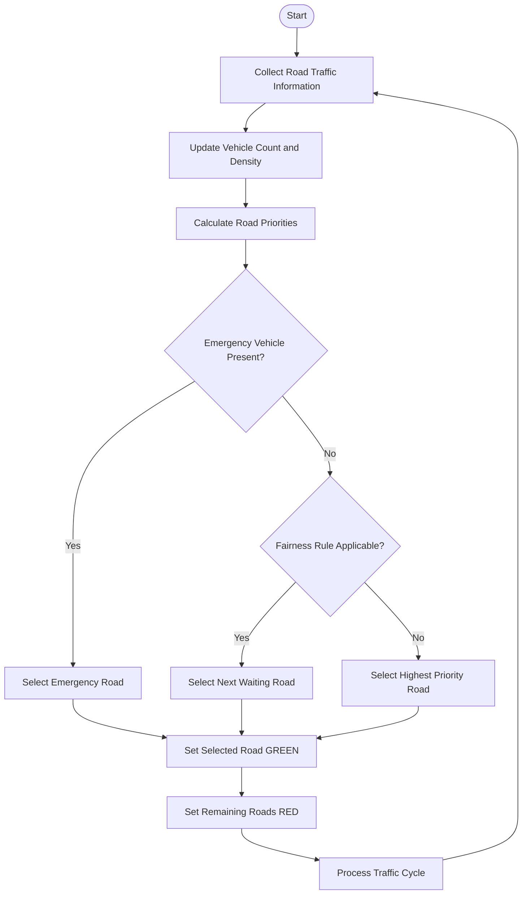
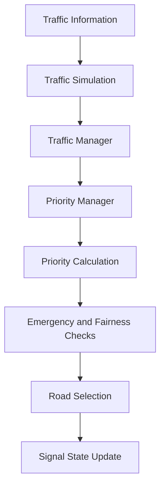

# 🚦 Adaptive Traffic Management System

### Smarter Signals. Smoother Traffic. Faster Emergency Response.

A priority-based traffic management system built using **C++17**, Data Structures and Algorithms, and Object-Oriented Programming.

<p align="center">
  
  
  
  
</p>

---

## 📌 Table of Contents

- [About the Project](#-about-the-project)
- [Key Features](#-key-features)
- [How It Works](#-how-it-works)
- [Priority Calculation](#-priority-calculation)
- [System Architecture](#-system-architecture)
- [Technology Stack](#-technology-stack)
- [Data Structures and Algorithms](#-data-structures-and-algorithms)
- [Project Structure](#-project-structure)
- [Getting Started](#-getting-started)
- [Testing](#-testing)
- [Integration Guide](#-integration-guide)
- [Design Decisions](#-design-decisions)
- [Current Limitations](#-current-limitations)
- [Future Roadmap](#-future-roadmap)
- [Module Ownership](#-module-ownership)
- [License](#-license)

---

## 🌍 About the Project

Traditional traffic signals generally operate using fixed timings, regardless of actual traffic conditions.

Consider an intersection where one road is almost empty while another road has a long queue of vehicles. A fixed-time signal may still give GREEN to the empty road.

The situation becomes even more critical when an ambulance is waiting at a congested intersection.

**Should traffic signals follow fixed timings, or should they respond to real traffic conditions?**

The **Adaptive Traffic Management System** explores a smarter approach.

It evaluates traffic information such as:

- Vehicle count
- Traffic density
- Waiting time
- Emergency vehicle presence
- Road activity and fairness

Based on these factors, the Traffic Intelligence Module determines which road should receive the next GREEN signal.

### 🎯 Project Objectives

- Reduce unnecessary vehicle waiting time.
- Give priority to emergency vehicles.
- Improve traffic distribution between roads.
- Prevent starvation of waiting roads.
- Make signal decisions based on traffic conditions rather than fixed rotation alone.

---

## ✨ Key Features

| Feature | Description |
|---|---|
| 🚑 Emergency Priority | Gives emergency vehicles priority during road selection. |
| 🚦 Adaptive Signal Selection | Selects the next GREEN road using traffic conditions. |
| 📊 Priority Calculation | Evaluates vehicle count, density and waiting time. |
| ⚖️ Fairness Management | Prevents the same road from receiving GREEN indefinitely. |
| 🚗 Vehicle Queue Management | Maintains waiting vehicles using a linked queue. |
| 🧠 Data Structures | Implements queues, heaps and hash tables. |
| 🔄 Traffic Simulation | Processes traffic updates and signal-selection cycles. |
| 🧪 Testing | Main test suite with 43 assertions, all passing. |

---

## 🔧 How It Works

The Traffic Intelligence Module evaluates the traffic conditions of available roads and determines which road should receive GREEN next.

### Traffic Decision Workflow



### Road Selection Algorithm

The `TrafficManager::selectNextRoad()` function follows four main steps.

| Step | Operation | Purpose |
|---|---|---|
| 1 | Emergency Priority | Checks active roads containing emergency vehicles. |
| 2 | Traffic Demand | Checks whether another road has traffic waiting. |
| 3 | Fairness | Applies round-robin selection when a road has received GREEN for three consecutive cycles and another road is waiting. |
| 4 | Highest Priority | Selects the road with the highest priority score. |

If multiple emergency vehicles are present on different roads, the system prefers the emergency vehicle closest to the front of its queue.

A road is considered to have **demand** when it reports vehicles or an emergency, rather than only when `Vehicle` objects are present in its queue. Roads populated through `updateRoadTraffic()` carry a vehicle count with no individually queued objects, so testing the queue alone would make those roads invisible to the selector.

The function returns the selected road index, or `-1` if no road can be served.

---

## 📊 Priority Calculation

The system calculates a priority score using multiple traffic factors.

### Priority Formula

```text
priority = 0                                  if the road is inactive

priority = EMERGENCY_WEIGHT                   if an emergency vehicle is present
         + vehicleCount   × VEHICLE_WEIGHT
         + trafficDensity × DENSITY_WEIGHT
         + waitingTime    × WAITING_WEIGHT
         + fairnessBonus  × FAIRNESS_WEIGHT   if applicable
```

### Priority Weights

| Parameter | Value | Purpose |
|---|---:|---|
| `EMERGENCY_WEIGHT` | 1000 | Emergency vehicle priority |
| `VEHICLE_WEIGHT` | 2 | Vehicle count |
| `DENSITY_WEIGHT` | 1 | Traffic density |
| `WAITING_WEIGHT` | 2 | Waiting time |
| `FAIRNESS_WEIGHT` | 5 | Fairness bonus |

### Why 1000 and Not 100?

The emergency weight was initially set to **100** during development.

An ambulance on a quiet road scored **103**. A heavy traffic jam containing 60 vehicles, with 100% density and 60 seconds of waiting time, scored **280**.

The traffic jam won, and the ambulance remained at a RED signal.

After increasing the emergency weight to **1000**, the same comparison produced:

| Scenario | Priority |
|---|---:|
| Ambulance on a quiet road | 1003 |
| Heavy traffic jam | 340 |

This demonstrated why the original emergency weight was insufficient.

The test suite includes an assertion to protect this behaviour:

```cpp
check("Ambulance road outranks the heaviest jam",
      system.getRoad(2)->getCurrentPriority() >
      system.getRoad(1)->getCurrentPriority());
```

### Emergency Selection Is Also Structural

Emergency vehicles are checked separately in the first step of `selectNextRoad()`.

Therefore, emergency selection does not depend only on the numerical priority score. The controller checks emergency roads before applying normal priority selection.

This is important because vehicle count and waiting time are not inherently bounded. A sufficiently large normal-traffic score could mathematically exceed the emergency weight.

### Fairness and Starvation Prevention

The system also considers how frequently a road has received GREEN.

If the same road has received GREEN for three consecutive cycles and another road has demand, the controller uses round-robin selection to give another waiting road an opportunity.

This helps prevent starvation and promotes fairer traffic distribution.

---

## 🧱 System Architecture

The Traffic Intelligence Module is responsible for traffic decision-making and signal selection.



### Main Components

| Component | Responsibility |
|---|---|
| `Vehicle` | Stores vehicle information and emergency status. |
| `Road` | Maintains road-related traffic information. |
| `VehicleQueue` | Manages waiting vehicles. |
| `PriorityManager` | Calculates priority scores and priority reasons. |
| `TrafficManager` | Manages roads and selects the next road. |
| `TrafficSimulation` | Drives traffic simulation cycles through the traffic manager. |

### Priority Reasons

`PriorityManager::getPriorityReason()` reports why a road was selected. Possible values:

- Road is inactive
- Emergency vehicle detected
- Fairness bonus for waiting road
- Long waiting time
- High traffic density
- High vehicle count
- Normal traffic priority

---

## 💻 Technology Stack

| Technology | Usage |
|---|---|
| C++17 | Core system implementation |
| Object-Oriented Programming | Class-based system design |
| Data Structures | Queue, Heap and Hash Table |
| Algorithms | Merge Sort and Searching |
| GCC | Compilation |
| Visual Studio Code | Development environment |
| Git and GitHub | Version control |

No external libraries are required. The source builds with C++11 or later; the commands in this README use C++17.

---

## 🧠 Data Structures and Algorithms

The project demonstrates the practical implementation of fundamental Data Structures and Algorithms.

| Data Structure / Algorithm | File | Purpose |
|---|---|---|
| Linked Queue | `queue.h` | Vehicle queue management |
| Binary Max Heap | `heap.h` | Road priority organization |
| Hash Table | `hashtable.h` | Road entry storage |
| Merge Sort | `sorting.h` | Sorting road information |
| Linear Search | `TrafficManager.cpp` | Road lookup |
| Vehicle Search | `searching.h` | Standalone search implementation |

### Implementation Status

`RoadHeap` and `RoadHashTable` are implemented and unit-tested, but they are not currently integrated into the controller's main road-selection and lookup paths.

- `selectNextRoad()` currently uses linear scans.
- `findRoadIndex()` currently uses linear lookup.

`RoadVehicleSearch` appears only inside `searching.h`. Nothing includes or uses it, including the tests. It is currently unintegrated code.

Integrating all three is listed under Future Roadmap.

### ⏱ Time Complexity Analysis

Let:

- `n` = number of roads
- `m` = number of vehicles in a road queue

| Operation | Time Complexity |
|---|---|
| Queue Enqueue | O(1) |
| Queue Dequeue | O(1) |
| Serve Emergency Vehicle | O(m) |
| Find Emergency Position | O(m) |
| Hash Table Insertion | O(1) average, O(n) worst |
| Hash Table Search | O(1) average, O(n) worst |
| Heap Insertion | O(log n) |
| Heap Peek | O(1) |
| Heap Extract Maximum | O(log n) |
| Merge Sort | O(n log n) |
| Linear Search | O(n) |
| Calculate Priority | O(1) |
| Calculate All Priorities | O(n) |
| Select Next Road | O(n × m) |
| Remove Road | O(n × m) |

### Why Merge Sort and Not Quick Sort?

Quick Sort has an average time complexity of O(n log n), but can degrade to O(n²) on already-sorted input, depending on pivot selection.

The road list here is almost always already sorted, because it is re-sorted every cycle and priorities change only slightly between cycles. This makes Quick Sort's worst case directly relevant.

Merge Sort provides O(n log n) time complexity in all cases and is stable, so roads with equal priority maintain their previous relative order.

The trade-off is O(n) additional memory for the merge buffer.

### Why Linear Search and Not Binary Search?

The road array is maintained in insertion order, not sorted order.

Binary Search requires sorted data. Applying it to an unsorted array does not simply make the search slower; it can return an incorrect result.

Therefore, Linear Search is the appropriate choice for the current road-array organization.

---

## 📁 Project Structure

```text
adaptive-traffic-management-system/
│
├── .vscode/
│   ├── c_cpp_properties.json
│   ├── launch.json
│   └── tasks.json
│
├── include/
│   ├── road.h                      Road state, encapsulation and validation
│   ├── vehicle.h                   Vehicle ID, type, arrival time, emergency flag
│   ├── queue.h                     VehicleQueue: linked FIFO, non-copyable
│   ├── heap.h                      RoadHeap: binary max heap
│   ├── hashtable.h                 RoadHashTable: separate chaining
│   ├── sorting.h                   RoadSorting: merge sort
│   ├── searching.h                 RoadVehicleSearch: linear search
│   ├── PriorityManager.h / .cpp    Priority formula and priority reasons
│   ├── TrafficManager.h / .cpp     Roads, queues, selection and signals
│   ├── TrafficSimulation.h / .cpp  Simulation cycles over the traffic manager
│   └── trafficintelligence.h       Display wrapper over TrafficManager
│
├── src/
│   └── main.cpp                    Demo program
│
├── test/
│   ├── test.cpp                    Main suite, 43 assertions
│   ├── emergency_*.cpp             Emergency precedence and queue ordering
│   ├── fairness_*.cpp              Fairness and starvation across cycles
│   ├── inactive_road_test.cpp      Inactive roads never receive GREEN
│   ├── manager_test.cpp            TrafficManager operations
│   ├── normal_priority_test.cpp    Ordinary priority ordering
│   ├── queue_position_test.cpp     FIFO ordering
│   ├── road_removal_test.cpp       Removal with remaining queues intact
│   └── probe.cpp                   Scratch program for manual inspection
│
├── .gitignore
└── README.md
```

---

## 🚀 Getting Started

Follow these instructions to build and run the project locally.

### Prerequisites

- C++17-compatible compiler (GCC recommended).
- Git.
- Visual Studio Code or another C++ development environment.

### 1. Clone the Repository

```bash
git clone https://github.com/palakbisht12/adaptive-traffic-managment-system.git
```

### 2. Navigate to the Project Directory

```bash
cd adaptive-traffic-managment-system
```

### 3. Compile the Application

```bash
g++ -std=c++17 -Iinclude src/main.cpp \
    include/PriorityManager.cpp \
    include/TrafficManager.cpp \
    include/TrafficSimulation.cpp \
    -o traffic_app
```

### 4. Run the Application

**Linux / macOS**

```bash
./traffic_app
```

**Windows**

```powershell
.\traffic_app.exe
```

---

## 🧪 Testing

Testing covers traffic selection, emergency handling, fairness, road management and queue operations.

### Main Test Suite

Compile:

```bash
g++ -std=c++17 -Iinclude test/test.cpp \
    include/PriorityManager.cpp \
    include/TrafficManager.cpp \
    include/TrafficSimulation.cpp \
    -o tests
```

Run:

```bash
./tests
```

Result:

```text
43 / 43 tests passed.
```

The suite compiles with **no warnings** under `-Wall -Wextra -Wpedantic`, and runs clean under AddressSanitizer and UndefinedBehaviorSanitizer (`-fsanitize=address,undefined`).

### Important Test Cases

| Test Scenario | Behaviour Protected |
|---|---|
| Ambulance priority | Prevents a heavy normal-traffic jam from outranking an ambulance. |
| Exactly one GREEN signal | Prevents two roads from receiving GREEN at the same time. |
| Multiple emergencies | Ensures emergency selection follows queue-position rules. |
| Fairness | Prevents one road from receiving GREEN indefinitely while another waits. |
| Inactive road | Prevents an inactive road from being selected for service. |
| Valid selection index | Prevents the selector from returning `-1` on a junction that has demand. |

### Other Test Programs

The `test/` directory contains 16 programs. Three of them assert and report pass or fail:

- `test.cpp` — the main suite, 43 assertions
- `emergency_queue_order_test.cpp`
- `emergency_manager_integration_test.cpp`

The remaining **13 print output for manual inspection** rather than asserting. Converting them is listed under Future Roadmap.

The same three `.cpp` implementation files link every test program. Substitute the test filename when compiling another test:

```bash
g++ -std=c++17 -Iinclude test/<test_file>.cpp \
    include/PriorityManager.cpp \
    include/TrafficManager.cpp \
    include/TrafficSimulation.cpp \
    -o test_program
```

For example:

```bash
g++ -std=c++17 -Iinclude test/emergency_test.cpp \
    include/PriorityManager.cpp \
    include/TrafficManager.cpp \
    include/TrafficSimulation.cpp \
    -o emergency_test
```

---

## 🔌 Integration Guide

The Traffic Intelligence Module can be integrated into a larger traffic management application.

### Header and Compilation

Include **`TrafficManager.h`**, not `trafficintelligence.h`.

`trafficintelligence.h` is a display wrapper that exposes only a subset of the available operations.

Compile against:

- `TrafficManager.cpp`
- `PriorityManager.cpp`
- `TrafficSimulation.cpp`

Use the `-I include` compiler option.

### Available Operations

| Application Operation | C++ Interface |
|---|---|
| Add a road | `addRoad(Road(id, name, vehicles, density, waiting, emergencies))` |
| Remove a road | `removeRoad(id)` |
| Retrieve road count | `getRoadCount()` |
| Retrieve road information | `getRoad(index)` or `getRoad(id)` |
| Update vehicle count and density | `updateRoadTraffic(id, vehicles, density)` |
| Update waiting time | `updateWaitingTime(id, seconds)` |
| Update traffic density | `updateTrafficDensity(id, density)` |
| Register emergency vehicle | `addEmergencyVehicle(id, Vehicle(vid, "Emergency", t, true))` |
| Remove a vehicle | `removeVehicle(id)` |
| Select next road | `selectNextRoad()` |
| Process traffic cycle | `processTrafficCycle()` |
| Change signal | `changeSignal(id, "GREEN")` or `changeSignal(id, "RED")` |

### Return Values and Conventions

- Every mutating call returns `bool`.
- `false` indicates an invalid road ID or invalid value.
- No method throws exceptions or exits the program.
- No method returns a pointer that the caller must free.
- Road IDs must be unique. Adding a duplicate road ID returns `false`.
- `getRoad(id)` returns a `Road*`, or `nullptr` if the road does not exist.
- `selectNextRoad()` returns the selected road index, or `-1` if no road can be served.

### Example Integration Mapping

| Application Endpoint | Suggested C++ Operation |
|---|---|
| `POST /road` | `addRoad()` |
| `DELETE /road/{id}` | `removeRoad()` |
| `GET /roads` | `getRoadCount()` and `getRoad(i)` |
| `GET /road/{id}` | `getRoad(id)` |
| `POST /traffic/update` | Traffic update methods |
| `POST /emergency/start` | `addEmergencyVehicle()` |
| `POST /emergency/end` | `removeVehicle()` |
| `GET /priority` | `selectNextRoad()` |
| `GET /traffic/state` | Road getters |
| Signal override | `changeSignal()` |

These endpoints describe a possible integration mapping. They are not implemented HTTP routes in this C++ module.

---

## 🧩 Design Decisions

The implementation includes several design choices made to avoid ownership problems and keep traffic selection consistent.

### 1. Why No Inheritance for Vehicle?

The `Vehicle` class uses an emergency flag instead of an inheritance hierarchy.

`VehicleQueue` stores vehicles by value. If derived vehicle objects were stored as base-class values, object slicing could occur, causing derived-class information to be lost.

### 2. Why Is VehicleQueue Non-Copyable?

`VehicleQueue` owns dynamically allocated linked-list nodes created using `new`.

Copying the queue without implementing deep-copy ownership would allow two queue objects to share the same nodes. When both destructors attempted to free those nodes, a double-free error could occur.

Therefore, copying is disabled.

### 3. Why Are Roads and Queues Stored in Parallel Arrays?

`Road` objects can be copied, but `VehicleQueue` objects are non-copyable because they own dynamically allocated memory.

The manager therefore maintains roads and their corresponding queues in parallel arrays.

This allows road information to be copied without copying queue ownership.

### 4. Why Is There Only One Selection Path?

The `TrafficIntelligence` wrapper delegates road selection to `TrafficManager::selectNextRoad()`.

This keeps one main decision-making path and prevents two separate selection implementations from disagreeing.

### 5. Why Is Demand Based on Reported Vehicle Counts?

Traffic demand is determined using reported vehicle counts or emergency information, rather than relying only on the contents of the vehicle queue.

This means the controller can use externally reported traffic information when making decisions.

---

## 🚧 Current Limitations

- Maximum road capacity is limited to `MAX_ROADS = 100`.
- The current implementation models a single junction.
- Priority weights are predefined rather than trained on real-world traffic data.
- The controller does not currently implement a timed YELLOW signal phase.
- Green signal duration is not modelled as a timed phase.
- One call to `processTrafficCycle()` represents a simulation step, not a complete real-time signal duration.
- The heap and hash table are not integrated into the main controller selection and lookup paths.
- `RoadVehicleSearch` is currently unintegrated.
- The controller writes messages to `cout`.

---

## 🧭 Future Roadmap

The following improvements focus on the Traffic Intelligence Module.

- [ ] Integrate `RoadHeap` into the road-selection process.
- [ ] Integrate `RoadHashTable` into road lookup.
- [ ] Integrate or remove `RoadVehicleSearch`.
- [ ] Normalize priority factors so emergency and fairness tiers cannot overlap arithmetically.
- [ ] Convert the 13 print-only test programs into assertion-based tests.
- [ ] Implement timed GREEN and YELLOW signal phases.
- [ ] Remove `using namespace std;` from headers and use explicit `std::` qualifiers.

---

## 👥 Module Ownership

This repository documents the **Traffic Intelligence Module implemented by Member 1**.

| Member | Module | Responsibility |
|---|---|---|
| **Member 1** | **Traffic Intelligence** | **Priority calculation, road selection, data structures, algorithms and simulation — this repository** |
| Member 2 | Database | Data storage, schema, repositories and traffic history |
| Member 3 | Frontend | Dashboard, user interface, controls and validation |
| Member 4 | Integration | Shared interfaces, API layer and end-to-end communication |

Only the Traffic Intelligence Module is implemented in this repository.

---

## 📄 License

Developed for academic coursework.

---

<p align="center">

**🚦 Building smarter traffic systems, one decision at a time.**

</p>
