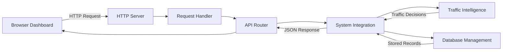

# 🚦 Adaptive Traffic Management System — Complete System

### Smarter Signals. Smoother Traffic. Faster Emergency Response.

A collaborative software engineering project developed by all four team members. The system integrates a C++17 traffic-decision engine, a pluggable database, a REST API over a built-in HTTP server, and an interactive browser dashboard.

<p align="center">
  
  
  
</p>

---

## 👥 Project Development

The Adaptive Traffic Management System is a collaborative project developed by all four team members.

Each member was responsible for the design, development, and implementation of their respective module. All four modules were integrated to build the complete application.

The project combines:

- Traffic Intelligence and Decision Making
- Database Management and Data Persistence
- Frontend Development and Visualization
- Backend Integration and REST API

Every module contributes to the functionality of the final system. The project represents the combined work and contributions of all four team members.

---

## 📌 Table of Contents

- [What It Does](#-what-it-does)
- [Quick Start](#-quick-start)
- [System Architecture](#-system-architecture)
- [Module 1 — Traffic Intelligence](#-module-1--traffic-intelligence)
- [Module 2 — Database Management](#-module-2--database-management)
- [Module 3 — Frontend Development](#-module-3--frontend-development)
- [Module 4 — System Integration and API](#-module-4--system-integration-and-api)
- [API Reference](#-api-reference)
- [Testing](#-testing)
- [Project Structure](#-project-structure)
- [Design Decisions](#-design-decisions)
- [Limitations](#-limitations)
- [Team Members](#-team-members)
- [License](#-license)

---

## 🌍 What It Does

Traditional traffic signals use fixed timings regardless of the actual traffic conditions on each road.

An empty road may receive a long GREEN signal while another road experiences heavy congestion. Emergency vehicles may also have to wait for the signal cycle to finish.

This system uses an adaptive traffic management approach.

It evaluates the condition of each road and selects the road that needs GREEN the most.

The system considers:

- Vehicle count
- Traffic density
- Waiting time
- Emergency vehicle presence
- Fairness between roads

It also provides an explanation for each traffic decision, which is displayed on the dashboard.

### System Workflow



---

## 🚀 Quick Start

### Requirements

- C++ compiler with C++17 support
- MinGW on Windows or GCC on Linux/macOS
- Modern web browser
- No external libraries required for the default FileStorage build

### Build and Run

**Linux / macOS**

```bash
make
make run
```

**Windows**

```powershell
.\build.bat
.\build.bat run
```

After starting the server, open:

**http://127.0.0.1:8080/**

### Expected Startup Output

```text
===========================================================
  ADAPTIVE TRAFFIC MANAGEMENT SYSTEM
===========================================================
  storage   : Storage ready (FileStorage)
  restore   : Restored 0 road(s) from storage
  roads     : Seeded 4 demo roads
  dashboard : http://127.0.0.1:8080/
  api       : http://127.0.0.1:8080/api/health
```

### Try It

1. Open the dashboard. Four roads are displayed.
2. Navigate to the Emergency section.
3. Select Chakrata Road and press Start Emergency.
4. Observe the signal switching to Chakrata Road.
5. The system displays the reason: Emergency vehicle detected.
6. Press Mark Completed to finish the emergency event.
7. Return to the Dashboard and enable Auto-run to observe traffic selection.

### Command-Line Options

```bash
./traffic_server --port 9000 --data mydata --no-seed --quiet
```

| Flag | Meaning |
|---|---|
| `--port N` | Listening port (default 8080) |
| `--data PATH` | Storage directory or `.db` file |
| `--frontend DIR` | Dashboard directory |
| `--no-seed` | Start without demo roads |
| `--quiet` | Disable request logging |

On Windows:

```powershell
.\traffic_server.exe --port 9000
```

---

## 🧱 System Architecture

The application is divided into four modules. Each module has its own responsibilities and communicates with the other modules through defined interfaces.


### Module Responsibilities

| Module | Development Area | Main Responsibility |
|---|---|---|
| Module 1 | Traffic Intelligence | Traffic priority calculation, road selection, data structures and traffic simulation |
| Module 2 | Database Management | Database design, storage implementation, repositories and data persistence |
| Module 3 | Frontend Development | Dashboard, user interface, traffic visualization and user controls |
| Module 4 | System Integration and API | Shared interfaces, REST API, HTTP server and integration of all modules |

All four modules work together as one integrated system.

The traffic decision logic is maintained in the Traffic Intelligence module. The frontend displays information received from the backend rather than independently calculating traffic priorities.

---

## 🧠 Module 1 — Traffic Intelligence

**Assigned Member: Member 1**

The Traffic Intelligence module manages roads, vehicles, vehicle queues, traffic priority, signal selection and traffic simulation.

It acts as the traffic decision-making component of the application.

### Priority Formula

```text
priority = 0
           if the road is inactive

priority = EMERGENCY_WEIGHT
         + vehicleCount   × VEHICLE_WEIGHT
         + trafficDensity × DENSITY_WEIGHT
         + waitingTime    × WAITING_WEIGHT
         + fairnessBonus  × FAIRNESS_WEIGHT
           if applicable
```

### Priority Parameters

| Parameter | Value |
|---|---:|
| `EMERGENCY_WEIGHT` | 1000 |
| `VEHICLE_WEIGHT` | 2 |
| `DENSITY_WEIGHT` | 1 |
| `WAITING_WEIGHT` | 2 |
| `FAIRNESS_WEIGHT` | 5 |

### Emergency Priority

Emergency vehicles receive significantly higher priority than normal traffic.

During development, the emergency weight was increased from 100 to 1000 because a normal congested road could otherwise receive a higher numerical score than a road containing an ambulance.

Example:

```text
Ambulance road:
1000 + 3 = 1003

Normal traffic road:
60 × 2 + 100 × 1 + 60 × 2 = 340
```

The ambulance road receives the higher priority.

Emergency handling is also explicitly checked before normal priority comparison in `selectNextRoad()`.

### Selection Algorithm

| Step | Rule |
|---|---|
| 1 | Check for emergency vehicles |
| 2 | Check whether demand exists on other roads |
| 3 | Apply fairness and round-robin selection when required |
| 4 | Otherwise select the road with the highest priority score |

The function returns the selected road index or `-1` if no road can be served.

### Data Structures and Algorithms

| Data Structure / Algorithm | Implementation | Complexity |
|---|---|---|
| Linked Queue | `queue.h` | Enqueue/dequeue O(1), emergency extraction O(m) |
| Binary Max Heap | `heap.h` | Insert O(log n), peek O(1) |
| Hash Table | `hashtable.h` | O(1) average, O(n) worst |
| Merge Sort | `sorting.h` | O(n log n) |
| Linear Search | `TrafficManager.cpp` | O(n) |

### Practical Application of DSA

| Structure | Application | Purpose |
|---|---|---|
| `RoadHashTable` | `findRoadIndex()` | Efficient road lookup |
| `RoadHeap` | Road selection | Priority-based road selection |
| `VehicleQueue` | Traffic management | Maintains vehicle arrival order |
| `RoadVehicleSearch` | `findVehiclePosition()` | Searches for vehicles in queues |
| Merge Sort | Road reports | Sorts roads by priority |

These data structures are integrated into the actual traffic management operations.

---

## 💾 Module 2 — Database Management

**Assigned Member: Member 2**

The Database Management module handles persistent storage and maintains traffic-related records.

It provides a common storage interface with two interchangeable backend implementations.

### Database Tables

| Table | Purpose |
|---|---|
| `roads` | Stores current road information |
| `traffic_history` | Stores traffic changes |
| `signal_history` | Stores signal transitions |
| `emergency_events` | Stores emergency start and completion records |

The database schema is available in:

```text
database/schema.sql
```

### Storage Backends

| Backend | Purpose | Requirements |
|---|---|---|
| FileStorage | File-based persistent storage | No additional dependencies |
| SqliteStorage | SQLite database storage | `sqlite3.c` and `sqlite3.h` |

Both storage implementations follow the common `IStorage` interface.

This allows the application to use different storage backends without changing the overall database interaction structure.

### FileStorage Implementation

The file backend stores each database table in a separate text file.

It uses `0x1F` (unit separator) between fields.

This avoids conflicts with ordinary road names and simplifies the storage format.

### Repository Pattern

The database provides four repositories:

- `RoadRepository`
- `TrafficRepository`
- `SignalRepository`
- `EmergencyRepository`

Repositories provide a structured interface for accessing database operations.

For example:

```cpp
addRoad(...);
```

allows road insertion without requiring callers to directly manage low-level storage operations.

### Error Handling

Database operations return an `OperationResult` containing a message and an HTTP status code.

| Situation | HTTP Status |
|---|---:|
| Duplicate road | 409 |
| Unknown road | 404 |
| Invalid value | 400 |
| Storage unavailable | 503 |

---

## 🌐 Module 3 — Frontend Development

**Assigned Member: Member 3**

The Frontend Development module provides the interactive browser dashboard.

It uses:

- HTML
- CSS
- JavaScript
- SVG

No frontend framework, build step or `node_modules` directory is required.

### Main Dashboard

The dashboard provides a visual representation of the traffic junction.

It displays:

- Four road approaches
- Queued vehicles
- Traffic signals
- Zebra crossings
- Waiting times
- Traffic priority
- Current signal status

The junction is rendered using SVG based on information received from the backend.

### Dashboard Tabs

| Tab | Features |
|---|---|
| Live View | Junction visualization, moving vehicles, traffic controls, priority and decision reason |
| Roads | Add, remove and update roads, inspect roads and search for vehicles |
| History | Traffic history, signal history and emergency history |

### Live Data Updates

The frontend periodically requests the latest traffic information:

```http
GET /api/traffic/state
```

The dashboard polls the backend every 1.2 seconds and updates the displayed information.

### Traffic Visualization

Roads are displayed according to their positions in the junction.

The visual queue is limited to seven vehicles per approach, with a `+N` indicator for additional vehicles.

This keeps the dashboard readable while the side panel displays the actual vehicle count.

Emergency vehicles are visually highlighted in red.

### Simulation Controls

The dashboard provides:

- Start
- Pause
- Resume
- Reset
- Step
- Auto-run

The simulation runs on the server rather than independently in the browser.

### Road Controls

Users can:

- Add new roads
- Remove existing roads
- Update vehicle counts
- Change traffic density
- Update waiting time
- Search for vehicles
- Empty all roads
- Set one vehicle on each road

An exact vehicle count can be entered through a number input instead of repeatedly pressing increment or decrement buttons.

### Frontend Validation

The frontend validates:

- Empty road IDs
- Duplicate road IDs
- Empty road names
- Non-numeric values
- Negative vehicle counts
- Traffic density outside the 0–100 range

Validation errors are displayed near the relevant input fields.

### Separation of Responsibilities

The frontend is responsible for displaying traffic information and collecting user input.

Traffic decisions are provided by the Traffic Intelligence module through the integrated backend API.

This keeps traffic calculations and user-interface responsibilities separate.

---

## 🔌 Module 4 — System Integration and API

**Assigned Member: Member 4**

The System Integration and API module connects all the other modules and enables communication between the frontend, traffic engine and database.

It includes:

- Shared data contract
- REST API
- HTTP server
- Request handling
- Error handling
- Module communication
- Data synchronization

### Shared Data Contract

The file:

```text
integration/traffic.h
```

defines shared structures used for communication between modules.

These include:

- `RoadState`
- `PriorityResult`
- `EmergencyInfo`
- `TrafficRecord`
- `SignalRecord`
- `SimulationState`
- `OperationResult`

These structures establish a common communication format across the application.

### Request Pipeline

The request pipeline follows:

```text
receive → validate → route → call module → persist → respond
```

`RequestHandler` manages common request-processing responsibilities:

- Request logging
- Request-body size protection
- Duplicate-request counting
- Exception handling

Unexpected exceptions are converted into HTTP 500 responses rather than terminating the server.

### Data Synchronization

Traffic Intelligence maintains the current traffic state, while the database maintains persistent records.

Mutating operations synchronize the current road information with storage.

Live traffic decisions are obtained from the Traffic Intelligence module rather than reconstructed from historical database records.

### HTTP Server

The HTTP server is implemented using raw sockets:

- Winsock on Windows
- BSD sockets on Linux and macOS

The server is single-threaded by design.

`TrafficManager` is not thread-safe, so processing one request at a time avoids concurrent access and data races without requiring additional locking complexity.

The server binds to:

```text
127.0.0.1
```

---

## 📡 API Reference

The REST API provides endpoints for road management, traffic updates, emergency handling, simulation controls and history retrieval.

### Road Management

| Method | Endpoint | Body / Query |
|---|---|---|
| GET | `/api/health` | — |
| GET | `/api/roads` | — |
| GET | `/api/road/{id}` | — |
| POST | `/api/road` | `{roadID, roadName, vehicleCount, trafficDensity, waitingTime}` |
| PUT | `/api/road/{id}` | `{vehicleCount, trafficDensity, waitingTime}` |
| DELETE | `/api/road/{id}` | — |

### Traffic Management

| Method | Endpoint | Body / Query |
|---|---|---|
| POST | `/api/traffic/update` | `{roadID, addVehicles, removeVehicles, trafficDensity, waitingTime}` |
| GET | `/api/traffic/state` | Roads, decision and simulation state |
| GET | `/api/priority` | — |
| POST | `/api/cycle` | Advance one traffic cycle |

### Emergency Management

| Method | Endpoint | Body |
|---|---|---|
| POST | `/api/emergency/start` | `{roadID, type}` |
| POST | `/api/emergency/end` | `{roadID}` |

### Simulation Controls

| Method | Endpoint | Body |
|---|---|---|
| POST | `/api/simulation/start` | — |
| POST | `/api/simulation/pause` | — |
| POST | `/api/simulation/resume` | — |
| POST | `/api/simulation/reset` | — |
| POST | `/api/simulation/speed` | `{intervalMs}` |

### History and Vehicle Search

| Method | Endpoint | Body / Query |
|---|---|---|
| GET | `/api/history/traffic` | `?roadID=&limit=` |
| GET | `/api/history/signal` | `?roadID=&limit=` |
| GET | `/api/history/emergency` | `?roadID=` |
| GET | `/api/vehicle/find` | `?roadID=&vehicleID=` |
| GET | `/api/queue` | `?roadID=` |
| POST | `/api/queue` | `{roadID, vehicleID, type}` |

The vehicle search endpoint returns a 1-based queue position.

### Standard Error Response

All API errors follow a common JSON structure:

```json
{
  "ok": false,
  "error": "Duplicate Road ID: R101",
  "code": 409
}
```

### HTTP Status Codes

| Status | Meaning |
|---|---|
| 400 | Invalid input |
| 404 | Unknown road or endpoint |
| 405 | Incorrect HTTP method |
| 409 | Duplicate road or invalid state transition |
| 500 | Unexpected server error |
| 503 | Storage unavailable |

### Example: Get Current Priority

```bash
curl http://127.0.0.1:8080/api/priority
```

Example response:

```json
{
  "valid": true,
  "roadID": "R102",
  "roadName": "Saharanpur Road",
  "priority": 300,
  "signalStatus": "GREEN",
  "reason": "Long waiting time",
  "errorMessage": ""
}
```

### Example: Start an Emergency

```bash
curl -X POST \
  -H "Content-Type: application/json" \
  -d '{"roadID":"R104","type":"Ambulance"}' \
  http://127.0.0.1:8080/api/emergency/start
```

Example response:

```json
{
  "ok": true,
  "message": "Emergency started on R104",
  "priority": {
    "valid": true,
    "roadID": "R104",
    "roadName": "Chakrata Road",
    "priority": 1038,
    "signalStatus": "GREEN",
    "reason": "Emergency vehicle detected"
  }
}
```

---

## 🧪 Testing

The project includes automated testing for the Traffic Intelligence, Database Management and System Integration modules.

### Run Tests

```bash
make test
```

### Test Results

```text
--- Traffic Intelligence Tests ---       58 / 58 passed.
--- Database Tests ---                   72 / 72 passed.
--- Integration Tests ---                76 / 76 passed.

Total: 206 / 206 automated assertions passed.
```

**Total: 206 automated assertions.**

The project also supports compilation with:

```text
-Wall -Wextra -Wpedantic
```

AddressSanitizer and UndefinedBehaviorSanitizer testing can be run using:

```bash
make asan
```

### Integration Test Scenarios

| Scenario | Expected Behaviour |
|---|---|
| Normal traffic | Exactly one road receives GREEN and a reason is provided |
| Emergency | An ambulance on the quietest road receives priority over a heavily congested road |
| Traffic increase | Adding vehicles changes the selected road when appropriate |
| Waiting time | Multiple roads receive GREEN over repeated cycles, preventing starvation |
| New emergency | Emergency traffic interrupts normal selection and control returns after completion |

### Error Paths Covered

The tests also cover:

- Malformed JSON
- Missing fields
- Non-numeric fields
- Duplicate road IDs
- Negative values
- Traffic density above 100
- Unknown roads
- Unknown endpoints
- Incorrect HTTP methods
- Path traversal
- Oversized request bodies
- Writes after disconnect
- Invalid simulation operations

### Testing Note

The 206 automated assertions are distributed across three test suites:

- Traffic Intelligence: 58 assertions
- Database Management: 72 assertions
- System Integration: 76 assertions

The Traffic Intelligence test directory contains 16 programs. Three programs use automated assertions, while the remaining programs provide output for manual inspection.

The Database and Integration test suites also contain automated assertions.

The frontend is not included in the 206 automated assertion count. The SQLite backend has a separate testing limitation documented in `database/README_SQLITE.md`.

---

## 📁 Project Structure

```text
adaptive-traffic-management-system/
│
├── include/                     Traffic Intelligence
│   ├── road.h
│   ├── vehicle.h
│   ├── queue.h
│   ├── heap.h
│   ├── hashtable.h
│   ├── sorting.h
│   ├── searching.h
│   ├── PriorityManager.h/.cpp
│   ├── TrafficManager.h/.cpp
│   ├── TrafficSimulation.h/.cpp
│   └── trafficintelligence.h
│
├── database/                    Database Management
│   ├── Database.h/.cpp
│   ├── FileStorage.h/.cpp
│   ├── SqliteStorage.h/.cpp
│   ├── RoadRepository.*
│   ├── TrafficRepository.*
│   ├── SignalRepository.*
│   ├── EmergencyRepository.*
│   ├── schema.sql
│   ├── database_test.cpp
│   └── README_SQLITE.md
│
├── frontend/                    Frontend Development
│   ├── index.html
│   ├── styles.css
│   └── app.js
│
├── integration/                 System Integration and API
│   ├── traffic.h/.cpp
│   ├── Integration.h/.cpp
│   ├── API.h/.cpp
│   ├── HttpServer.h/.cpp
│   ├── RequestHandler.h/.cpp
│   ├── ErrorHandler.h/.cpp
│   ├── Json.h/.cpp
│   └── integration_test.cpp
│
├── src/
│   └── main.cpp
│
├── test/
│
├── main.cpp                     Integrated system entry point
├── Makefile                     Linux / macOS build
├── build.bat                    Windows build
└── README.md
```

---

## 🧩 Design Decisions

### 1. Vehicle Representation

`VehicleQueue` stores vehicles by value.

Using derived objects in a container of base objects can cause object slicing, where the derived portion is discarded.

The vehicle-type difference is represented using a boolean, so inheritance is unnecessary for this design.

### 2. VehicleQueue Is Non-Copyable

`VehicleQueue` owns dynamically allocated nodes using `new`.

A compiler-generated copy would duplicate pointers, potentially causing two queues to share the same nodes and resulting in double-free errors.

### 3. Roads and Queues in Parallel Arrays

`Road` objects can be copied into the heap and report arrays, but `VehicleQueue` cannot be copied.

Keeping roads and queues in separate parallel arrays allows both types of data to be managed appropriately.

### 4. Hash Table Stores an Index

The hash table stores a road index instead of a complete `Road` object.

This avoids maintaining duplicate copies of road data and allows efficient lookup.

### 5. Hash Table Rebuild After removeRoad()

Removing a road shifts subsequent roads to different array positions.

This invalidates indexes stored in the hash table.

Therefore, `removeRoad()` rebuilds the hash table to maintain correct lookups.

### 6. Linear Search Over the Vehicle Queue

The vehicle queue maintains arrival order rather than sorted vehicle IDs.

Binary search requires sorted data, so linear search is appropriate for finding a vehicle by ID.

### 7. Merge Sort Instead of Quick Sort

Merge sort guarantees O(n log n) time complexity in all cases and is stable.

It provides predictable sorting performance for priority-ordered road reports.

### 8. One Selection Path

`TrafficIntelligence` delegates road selection to:

```cpp
TrafficManager::selectNextRoad()
```

Maintaining one selection path ensures consistent traffic decisions throughout the application.

### 9. Demand Based on Reported Counts

Demand is measured using reported vehicle counts rather than only queue contents.

Roads populated through `updateRoadTraffic()` may have a vehicle count without individually queued vehicle objects.

Using queue contents alone would make these roads invisible to the selection algorithm.

### 10. Two Storage Backends Behind One Interface

The project provides FileStorage and SqliteStorage behind the common `IStorage` interface.

This separates database implementation details from the rest of the application.

### 11. Single-Threaded HTTP Server

The HTTP server processes one request at a time.

Since `TrafficManager` is not thread-safe, this avoids concurrent modifications and data races without requiring additional locking mechanisms.

### 12. Field Separator 0x1F

FileStorage uses `0x1F` as a separator between fields.

This avoids conflicts with ordinary user-entered road names and simplifies the storage format.

---

## 🚧 Limitations

Although the project provides a complete traffic management simulation, several limitations remain:

- `MAX_ROADS = 100` is a compile-time constant.
- The system currently supports a single junction.
- There is no coordination between adjacent traffic junctions.
- Priority weights are based on design decisions rather than trained models or measured real-world traffic data.
- There are no real-time timed GREEN or YELLOW phases.
- `processTrafficCycle()` represents a simulation step rather than an actual signal duration.
- `TrafficManager` prints progress messages to `cout`, which also appear in the server log.
- The HTTP server is single-threaded.
- HTTPS and persistent HTTP keep-alive connections are not supported.
- The SQLite backend is implemented but remains untested in the current build environment. Refer to `database/README_SQLITE.md`.

---

## 👥 Team Members

The Adaptive Traffic Management System was developed collaboratively by all four team members.

Each member was responsible for designing, developing and implementing their respective module. All four contributions were integrated into the final application.

| Member | Assigned Module | Contribution |
|---|---|---|
| **Member 1** | **Traffic Intelligence** | Traffic algorithms, data structures, priority calculation, road selection, vehicle queues and traffic simulation |
| **Member 2** | **Database Management** | Database design, storage implementation, repositories, data persistence and traffic history |
| **Member 3** | **Frontend Development** | Dashboard development, user interface, traffic visualization, road controls and frontend validation |
| **Member 4** | **System Integration and API** | Shared interfaces, REST API, HTTP server, request handling, error handling and integration of all modules |

### Collaborative Contribution

All four members completed their respective responsibilities and contributed to the development of the complete Adaptive Traffic Management System.

The final application combines:

- Data Structures and Algorithms
- Object-Oriented Programming
- Database Management
- Frontend Development
- Backend Development
- REST API Integration
- Software Testing

The four modules work together as one unified application. Each member's contribution is an essential part of the completed project.

---

## 📄 License

Developed collaboratively for academic coursework.

---

<p align="center">

**🚦 Building smarter traffic systems, one decision at a time.**

</p>
