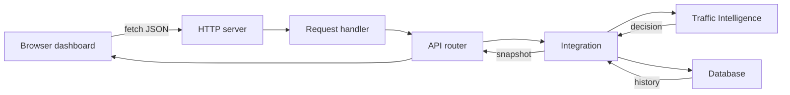

# 🚦 Adaptive Traffic Management System — Complete System

### Smarter Signals. Smoother Traffic. Faster Emergency Response.

All four modules, integrated and running: a C++17 traffic-decision engine, a
pluggable database, a REST API over a built-in HTTP server, and a browser
dashboard.

<p align="center">
  
  
  
</p>

---

## ⚠️ Read this first

**Only Member 1's Traffic Intelligence module is original coursework.**

Members 2, 3 and 4 in this repository are a **reference implementation**
written to demonstrate integration and to give the rest of the team a
concrete target to build against. They are not a substitute for anyone's own
submission. Each member is expected to write their own module; this shows
what the interfaces between them have to look like.

---

## 📌 Table of Contents

- [What It Does](#-what-it-does)
- [Quick Start](#-quick-start)
- [System Architecture](#-system-architecture)
- [Module 1 — Traffic Intelligence](#-module-1--traffic-intelligence)
- [Module 2 — Database](#-module-2--database)
- [Module 3 — Frontend](#-module-3--frontend)
- [Module 4 — Integration and API](#-module-4--integration-and-api)
- [API Reference](#-api-reference)
- [Testing](#-testing)
- [Project Structure](#-project-structure)
- [Design Decisions](#-design-decisions)
- [Limitations](#-limitations)
- [Team](#-team)

---

## 🌍 What It Does

A fixed-time traffic signal gives every road the same green period regardless
of what is on it. An empty street gets sixty seconds while a queue builds
beside it, and an ambulance waits for a timer.

This system replaces the timer with a decision. Every cycle it scores each
road on vehicle count, traffic density, waiting time, emergency presence and
fairness, then gives GREEN to the road that needs it — with an explicit
reason that the dashboard displays.



---

## 🚀 Quick Start

### Requirements

- `g++` with C++17 (MinGW on Windows)
- A browser
- No libraries to install

### Build and run

**Linux / macOS**

```bash
make
make run
```

**Windows**

```powershell
.\build.bat
.\build.bat run
```

PowerShell will not run a script from the current folder without the `.\`
prefix. In `cmd.exe` the prefix is optional.

Then open **<http://127.0.0.1:8080/>**.

```
===========================================================
  ADAPTIVE TRAFFIC MANAGEMENT SYSTEM
===========================================================
  storage   : Storage ready (FileStorage)
  restore   : Restored 0 road(s) from storage
  roads     : Seeded 4 demo roads
  dashboard : http://127.0.0.1:8080/
  api       : http://127.0.0.1:8080/api/health
```

### Try it

1. Open the dashboard. Four roads load; Saharanpur Road holds GREEN.
2. Go to **Emergency**, pick **Chakrata Road** — the *quietest* road — and
   press **Start emergency**.
3. The signal jumps to Chakrata Road with the reason *Emergency vehicle
   detected*. An ambulance on an empty street beats a 75-vehicle jam.
4. Press **Mark completed**. Control returns to the jam.
5. Back on **Dashboard**, tick **Auto-run** and watch the roads take turns.

### Options

```bash
./traffic_server --port 9000 --data mydata --no-seed --quiet
```

| Flag | Meaning |
|---|---|
| `--port N` | listen port (default 8080) |
| `--data PATH` | storage directory or `.db` file (default `traffic_data`) |
| `--frontend DIR` | where the dashboard files live (default `frontend`) |
| `--no-seed` | start with no roads |
| `--quiet` | do not log every request |

On Windows prefix with `.\`: `.\traffic_server.exe --port 9000`

---

## 🧱 System Architecture


**The ownership rule holds throughout.** Member 1 decides, Member 2 stores,
Member 3 displays, Member 4 connects. The priority formula exists in exactly
one file and nothing else recomputes it — notably, `app.js` contains no
arithmetic on priority at all.

---

## 🧠 Module 1 — Traffic Intelligence

The decision engine. See the detailed notes in the source comments.

### Priority formula

```text
priority = 0                                  if the road is inactive

priority = EMERGENCY_WEIGHT                   if an emergency vehicle is present
         + vehicleCount   × VEHICLE_WEIGHT
         + trafficDensity × DENSITY_WEIGHT
         + waitingTime    × WAITING_WEIGHT
         + fairnessBonus  × FAIRNESS_WEIGHT   if applicable
```

| Parameter | Value |
|---|---:|
| `EMERGENCY_WEIGHT` | 1000 |
| `VEHICLE_WEIGHT` | 2 |
| `DENSITY_WEIGHT` | 1 |
| `WAITING_WEIGHT` | 2 |
| `FAIRNESS_WEIGHT` | 5 |

**Why 1000 and not 100.** The weight was 100 during development. An ambulance
on a quiet road scored **103**; a jam of 60 vehicles at 100% density with 60
seconds of waiting scored **280**. The jam won and the ambulance sat at a red
light. At 1000 the same comparison gives **1003** against **340**. A test
asserts this and fails if the weight is ever lowered again.

Emergency handling is also **structural**: `selectNextRoad()` checks
emergency roads in step 1, before any score comparison, so the override does
not depend on the arithmetic.

### Selection algorithm

| Step | Rule |
|---|---|
| 1 | Emergency road wins; among several, the ambulance nearest the queue front |
| 2 | Is there demand on any road other than the last one served? |
| 3 | Fairness — after three consecutive greens, round-robin to the next waiting road |
| 4 | Otherwise, highest priority score |

Returns the road index, or `-1` if nothing can be served.

### Data structures

| Structure | File | Complexity |
|---|---|---|
| Linked queue | `queue.h` | enqueue/dequeue O(1), emergency extract O(m) |
| Binary max heap | `heap.h` | insert O(log n), peek O(1) |
| Hash table | `hashtable.h` | O(1) average, O(n) worst |
| Merge sort | `sorting.h` | O(n log n) all cases |
| Linear search | `TrafficManager.cpp` | O(n) |

**All five structures are on real paths**, not merely implemented:

| Structure | Used by | Spec |
|---|---|---|
| `RoadHashTable` | `findRoadIndex()` — O(1) road lookup, replacing an O(n) scan | 1.5 |
| `RoadHeap` | `selectNextRoad()` step 4 — picks the highest-priority road | 1.4 |
| `RoadVehicleSearch` | `findVehiclePosition()` — a vehicle's place in a road's queue | 1.7 |
| `VehicleQueue` | per-road waiting vehicles, emergency extraction | 1.3 |
| Merge sort | priority-ordered road reports | 1.6 |

Fifteen assertions under *DSA integration* fail if any of the first three is
bypassed. Removing the hash-table rebuild in `removeRoad()` — the classic
index-invalidation bug, where lookups keep succeeding and return the *wrong*
road — makes three of them fail and the suite segfault.

---

## 💾 Module 2 — Database

Four tables, two interchangeable backends behind one interface.

| Table | Holds |
|---|---|
| `roads` | current state of every approach |
| `traffic_history` | one row per traffic change |
| `signal_history` | one row per signal transition |
| `emergency_events` | start and completion of each emergency |

Full DDL in `database/schema.sql`.

### Two backends

| Backend | When | Needs |
|---|---|---|
| **FileStorage** (default) | always works | nothing |
| **SqliteStorage** | `make sqlite` | `sqlite3.c` + `sqlite3.h` |

Both implement `IStorage` and both are driven by the same 72 assertions, so
swapping them cannot change behaviour. See `database/README_SQLITE.md` for
the two-file setup — and note the honest caveat there about the SQLite path
being untested in the build environment.

The file backend stores each table as one text file with `0x1F` (unit
separator) between fields. That character cannot be typed into a road name,
so the format needs no escaping and a road called `Main Road, East` cannot
corrupt it.

### Repositories

`RoadRepository`, `TrafficRepository`, `SignalRepository`,
`EmergencyRepository` — a named vocabulary over `Database` so callers say
`addRoad(...)` rather than assembling storage calls.

### Error handling

Nothing throws. Every call returns `OperationResult` with a message and an
HTTP status: duplicate road → 409, unknown road → 404, invalid value → 400,
storage down → 503.

---

## 🌐 Module 3 — Frontend

Plain HTML, CSS and JavaScript. No framework, no build step, no `node_modules`.

The main screen is a **top-down live view of the junction**: four approaches,
queued vehicles, traffic lights, zebra crossings and per-road waiting times,
all drawn as SVG from whatever the backend reports.

| Tab | Spec | Contains |
|---|---|---|
| **Live View** | 3.1, 3.4, 3.5, 3.6, 3.7 | the junction with moving vehicles, road controls (− / typed count / + / Send), current priority and reason, Start · Pause · Resume · Reset · Step, cycle speed |
| **Roads** | 3.2, 3.3 | add, remove, update traffic, inspect a road, find a vehicle in its queue |
| **History** | — | traffic, signal and emergency records from storage |

The page polls `GET /api/traffic/state` every 1.2 seconds and re-renders.

### Reading the junction

Roads map to compass points **in the order the backend lists them** — first
road north, then east, south, west. Traffic keeps right, so each approach
occupies the lane on the right of its own direction of travel; that is why
the northern queue sits west of the centre line.

The drawn queue is capped at seven vehicles with a `+N` marker for the rest.
Showing 500 cars would not fit on the approach and would be unreadable; the
side panel carries the real count. An active emergency is drawn **red at the
head of the queue**, matching the backend, which serves emergency vehicles
out of FIFO order.

### The simulation runs in the server, not the browser

`Start` sets the state to RUNNING and the **server** advances a cycle every
`cycleIntervalMs`. It does this from the HTTP server's idle beat: `accept()`
waits on `select()` with a 50 ms timeout instead of blocking forever, so the
process has time to do its own work between requests.

An earlier version set a `SimulationState` enum that nothing ever read, and
let a timer in the browser post `/api/cycle`. That made Start and Pause
decorative, left two clocks fighting each other, and stopped the simulation
dead whenever no browser was open.

`Pause` genuinely freezes the cycle counter; `Resume` restarts it on the
next beat. `Step` runs exactly one cycle regardless of state.

### Setting an exact vehicle count

Each row in Road Controls has a **typed number box** between `−` and `+`.
Type a value, press Enter, and `PUT /api/road/{id}` replaces the count
outright. Getting from 40 vehicles to 10 by clicking minus thirty times is
not a control.

`Empty all roads` and `1 vehicle each` set every road at once — useful for
watching a single vehicle cross the junction.

The panel does not rebuild while a box has focus, so a poll cannot wipe a
half-typed number.

### Validation (spec 3.8)

Checked before anything is sent: empty road ID, duplicate ID, empty name,
non-numeric input, negative counts, density outside 0–100. Failures appear
under the offending field, not in an alert box.

### The frontend contains no priority formula

It displays the number and the reason the backend returns. Re-deriving even a
simplified version in JavaScript is how a dashboard ends up disagreeing with
the controller it is supposed to display.

### If you open index.html directly

It will load and look correct, but the junction will be empty and a red
banner will tell you to start the server. The dashboard has no traffic logic
of its own, by design — the decisions come from Member 1's module over HTTP.

Asset paths are **relative** (`styles.css`, not `/styles.css`). An absolute
path resolves to the drive root when the file is opened from disk, which
loads nothing and leaves the page unstyled with every panel stacked at once.

All user-supplied text is inserted with `textContent`, never `innerHTML`, so
a road named `` renders as text.

## 🔌 Module 4 — Integration and API

### Shared contract

`integration/traffic.h` defines `RoadState`, `PriorityResult`,
`EmergencyInfo`, `TrafficRecord`, `SignalRecord`, `SimulationState` and
`OperationResult`. These are plain structs with no behaviour, which is what
makes them a stable boundary: Member 1 can change `Road` freely without
forcing Member 2 to recompile.

### Request pipeline (spec 4.4)

```
receive → validate → route → call module → persist → respond
```

`RequestHandler` owns the cross-cutting parts: request logging, the
oversized-body guard, the duplicate-request counter, and a `catch (...)` that
turns an unexpected exception into a 500 instead of killing the server.

### Synchronisation (spec 4.8)

Traffic Intelligence is the single source of truth for live state; the
database is the record of it. Every mutating call ends by writing the
manager's view of every road back to storage. Nothing reads live state out of
the database. If the two ever disagree, the manager wins and the next sync
corrects the record.

### HTTP server

Written on raw sockets — Winsock on Windows, BSD sockets elsewhere.
Single-threaded on purpose: `TrafficManager` is not thread-safe, and serving
one request at a time removes every data race from the design rather than
papering over them with locks. Bound to `127.0.0.1` only.

---

## 📡 API Reference

| Method | Endpoint | Body / Query |
|---|---|---|
| `GET` | `/api/health` | — |
| `GET` | `/api/roads` | — |
| `GET` | `/api/road/{id}` | — |
| `POST` | `/api/road` | `{roadID, roadName, vehicleCount, trafficDensity, waitingTime}` |
| `PUT` | `/api/road/{id}` | any of `{vehicleCount, trafficDensity, waitingTime}` |
| `DELETE` | `/api/road/{id}` | — |
| `POST` | `/api/traffic/update` | `{roadID, addVehicles, removeVehicles, trafficDensity, waitingTime}` |
| `GET` | `/api/traffic/state` | roads + decision + simulation state |
| `POST` | `/api/emergency/start` | `{roadID, type}` |
| `POST` | `/api/emergency/end` | `{roadID}` |
| `GET` | `/api/priority` | — |
| `POST` | `/api/cycle` | advance one traffic cycle |
| `POST` | `/api/simulation/start` \| `pause` \| `resume` \| `reset` | — |
| `POST` | `/api/simulation/speed` | `{intervalMs}` — ms between cycles |
| `GET` | `/api/history/traffic` | `?roadID=&limit=` |
| `GET` | `/api/history/signal` | `?roadID=&limit=` |
| `GET` | `/api/history/emergency` | `?roadID=` |
| `GET` | `/api/vehicle/find` | `?roadID=&vehicleID=` → 1-based queue position |
| `GET` | `/api/queue` | `?roadID=` → everything waiting on that road, in order |
| `POST` | `/api/queue` | `{roadID, vehicleID, type}` — put a named vehicle on a road |

Every error has the same shape, so the dashboard has one error path:

```json
{ "ok": false, "error": "Duplicate Road ID: R101", "code": 409 }
```

| Status | Meaning |
|---|---|
| 400 | invalid input — retrying will not help |
| 404 | unknown road or endpoint |
| 405 | wrong HTTP method |
| 409 | duplicate road, or simulation already in that state |
| 500 | unexpected server error |
| 503 | storage unavailable |

### Example

```bash
curl http://127.0.0.1:8080/api/priority
```

```json
{"valid":true,"roadID":"R102","roadName":"Saharanpur Road",
 "priority":300,"signalStatus":"GREEN","reason":"Long waiting time",
 "errorMessage":""}
```

```bash
curl -X POST -H "Content-Type: application/json" \
     -d '{"roadID":"R104","type":"Ambulance"}' \
     http://127.0.0.1:8080/api/emergency/start
```

```json
{"ok":true,"message":"Emergency started on R104",
 "priority":{"valid":true,"roadID":"R104","roadName":"Chakrata Road",
 "priority":1038,"signalStatus":"GREEN",
 "reason":"Emergency vehicle detected"}}
```

---

## 🧪 Testing

```bash
make test
```

```
--- MEMBER 1: Traffic Intelligence ---   58 / 58 tests passed.
--- MEMBER 2: Database ---               72 / 72 tests passed.
--- MEMBER 4: Integration ---            76 / 76 tests passed.
```

**206 assertions total.** Zero warnings under `-Wall -Wextra -Wpedantic`, and
all three suites run clean under AddressSanitizer and UndefinedBehaviorSanitizer:

```bash
make asan
```

### The five integration scenarios (spec 4.12)

| Scenario | Asserted |
|---|---|
| 1 — Normal traffic | exactly one road GREEN; decision carries a reason |
| 2 — Emergency | ambulance on the *quietest* road outranks a 75-vehicle jam; score > 1000 |
| 3 — Traffic increase | adding 500 vehicles changes the selected road |
| 4 — Waiting time | over 40 cycles, three different roads receive GREEN — no starvation |
| 5 — New emergency | emergency interrupts; the waiting road stays tracked; control returns after |

### Error paths covered

Malformed JSON, missing fields, non-numeric fields, duplicate IDs, negative
values, density > 100, unknown roads, unknown endpoints, wrong HTTP methods,
path traversal (`/../etc/passwd`), oversized bodies, writes after disconnect,
and pausing a simulation that is not running.

### Honest note

Three of the sixteen programs in `test/` assert; the other thirteen print
output for manual inspection. `database_test.cpp` and `integration_test.cpp`
both assert throughout.

---

## 📁 Project Structure

```text
adaptive-traffic-management-system/
│
├── include/                     MEMBER 1 — Traffic Intelligence
│   ├── road.h  vehicle.h  queue.h  heap.h  hashtable.h
│   ├── sorting.h  searching.h
│   ├── PriorityManager.h/.cpp   the formula and the reasons
│   ├── TrafficManager.h/.cpp    roads, queues, selection, signals
│   ├── TrafficSimulation.h/.cpp simulation cycles
│   └── trafficintelligence.h    display wrapper
│
├── database/                    MEMBER 2 — Storage
│   ├── Database.h/.cpp          façade + IStorage interface
│   ├── FileStorage.h/.cpp       default backend, no dependencies
│   ├── SqliteStorage.h/.cpp     real SQLite  (-DUSE_SQLITE)
│   ├── RoadRepository.*  TrafficRepository.*
│   ├── SignalRepository.*  EmergencyRepository.*
│   ├── schema.sql               four tables, indexes, cascades
│   ├── database_test.cpp        72 assertions
│   └── README_SQLITE.md         two-file setup guide
│
├── frontend/                    MEMBER 3 — Dashboard
│   ├── index.html               five tabs
│   ├── styles.css               light + dark, no framework
│   └── app.js                   API client, validation, rendering
│
├── integration/                 MEMBER 4 — Glue
│   ├── traffic.h/.cpp           SHARED CONTRACT
│   ├── Integration.h/.cpp       the controller
│   ├── API.h/.cpp               REST routes
│   ├── HttpServer.h/.cpp        raw sockets, Windows + POSIX
│   ├── RequestHandler.h/.cpp    pipeline, logging, guards
│   ├── ErrorHandler.h/.cpp      one error shape
│   ├── Json.h/.cpp              minimal writer + parser
│   └── integration_test.cpp     76 assertions, 5 scenarios
│
├── src/main.cpp                 Member 1 standalone console demo
├── test/                        Member 1 tests (16 programs)
├── main.cpp                     MEMBER 4 — system entry point
├── Makefile                     Linux / macOS
├── build.bat                    Windows
└── README.md
```

---

## 🧩 Design Decisions

**No inheritance for `Vehicle`.** `VehicleQueue` stores vehicles *by value*.
A derived object pushed into a container of base objects is **sliced** — the
derived part is silently discarded. The only thing that varies by type is one
boolean.

**`VehicleQueue` is non-copyable.** It owns `new` nodes. A compiler-generated
copy would duplicate the pointers, two queues would share nodes, and both
destructors would free them. Double free.

**Roads and queues in parallel arrays.** `Road` is copied into the heap and
into report arrays; `VehicleQueue` cannot be copied. Separating them keeps
copyable state copyable.

**The hash table stores an index, not a `Road`.** Storing the whole road
would give two copies of every road and every update would have to write
both. The table is an *index*, in the database sense.

**The hash table stores an index, and `removeRoad()` rebuilds it.** Removing
a road shifts every later road down a slot, invalidating every stored index
from that point on. Skipping the rebuild does not cause a crash at the point
of the bug — lookups keep succeeding and quietly return the wrong road.

**Linear search over the vehicle queue, not binary.** The queue is in arrival
order, which is not sorted by vehicle ID. Binary search on unsorted data does
not return an answer slowly; it returns a wrong one. The algorithm is forced
by how the data is stored.

**Merge sort, not quick sort.** The road list is re-sorted every cycle and
priorities change only slightly between cycles, so the input is almost always
already sorted — precisely quick sort's O(n²) worst case. Merge sort is
O(n log n) always, and stable.

**One selection path.** `TrafficIntelligence` delegates to
`TrafficManager::selectNextRoad()`. An earlier version had its own fallback
loop and the two classes returned different answers for identical input.

**Demand is measured by reported counts, not queue contents.** Roads
populated through `updateRoadTraffic()` carry a vehicle count with nothing
queued individually. Testing the queue instead made those roads invisible and
froze the whole junction with no green anywhere.

**Two storage backends behind one interface.** The file backend exists so the
project builds on a machine without the SQLite amalgamation; the SQLite
backend exists because that is what a real deployment uses. Identical tests
drive both.

**The HTTP server is single-threaded.** `TrafficManager` is not thread-safe.
Serving one request at a time eliminates data races by construction, which is
more defensible than adding locks to someone else's module.

**Field separator `0x1F`.** A user cannot type it into a road name, so the
file format needs no escaping rules.

---

## 🚧 Limitations

- `MAX_ROADS = 100`, a compile-time constant.
- Single junction; no coordination between adjacent junctions.
- Priority weights are reasoned design values, not fitted to measured traffic.
- No timed GREEN or YELLOW phase; one `processTrafficCycle()` is a simulation
  step, not a real-time signal duration.
- `TrafficManager` prints progress messages to `cout`; they land in the server
  log, harmlessly, but a library should not print.
- The HTTP server handles one request at a time and does not support HTTPS or
  keep-alive.
- The SQLite backend is written but untested — see `database/README_SQLITE.md`.

---

## 👥 Team

| Member | Module | Responsibility |
|---|---|---|
| **Member 1** | **Traffic Intelligence** | **Priority calculation, road selection, DSA, OOP, simulation — original work** |
| Member 2 | Database | Storage, schema, repositories, history — *reference implementation* |
| Member 3 | Frontend | Dashboard, controls, validation — *reference implementation* |
| Member 4 | Integration | Shared contract, API, server, synchronisation — *reference implementation* |

---

## 📄 License

Developed for academic coursework.

---

<p align="center">

**🚦 Building smarter traffic systems, one decision at a time.**

</p>
