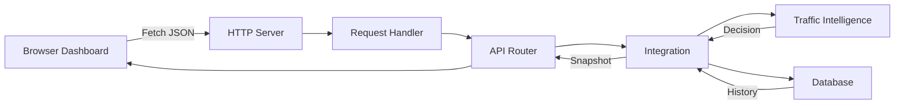
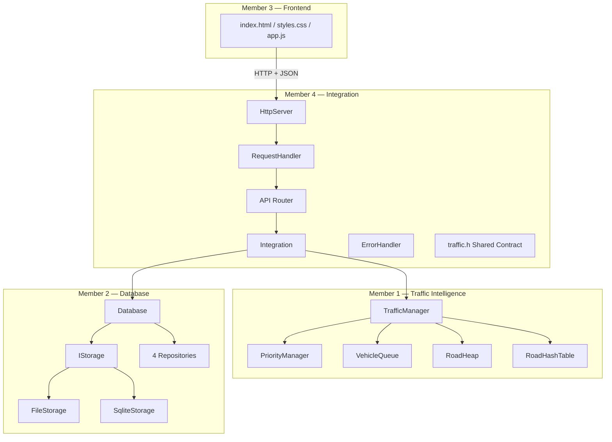

# 🚦 Adaptive Traffic Management System — Complete System

### Smarter Signals. Smoother Traffic. Faster Emergency Response.

A collaborative software engineering project developed by all four team members. The system integrates a C++17 traffic-decision engine, a pluggable database, a REST API over a built-in HTTP server, and an interactive browser dashboard.

<p align="center">
  
  
  
</p>

---

## 👥 Project Development

**The Adaptive Traffic Management System is a collaborative project developed by all four team members.**

All four members contributed to the design, development, implementation, integration, and testing of their respective modules.

- **Member 1** — Traffic Intelligence
- **Member 2** — Database Management
- **Member 3** — Frontend Development
- **Member 4** — System Integration and REST API

Each member was responsible for developing a dedicated module. All four modules were integrated to create one complete traffic management application.

---

## 📌 Table of Contents

- [What It Does](#-what-it-does)
- [Quick Start](#-quick-start)
- [System Architecture](#-system-architecture)
- [Module 1 — Traffic Intelligence](#-module-1--traffic-intelligence)
- [Module 2 — Database](#-module-2--database)
- [Module 3 — Frontend](#-module-3--frontend)
- [Module 4 — Integration and API](#-module-4--integration-and-api)
- [API Reference](#-api-reference)
- [Testing](#-testing)
- [Project Structure](#-project-structure)
- [Design Decisions](#-design-decisions)
- [Limitations](#-limitations)
- [Team Members](#-team-members)
- [License](#-license)

---

## 🌍 What It Does

A fixed-time traffic signal gives every road the same green period regardless of what is happening on it. An empty street gets sixty seconds while a queue builds beside it, and an ambulance waits for a timer.

This system replaces the fixed timer with an intelligent decision-making mechanism.

Every cycle, the system evaluates each road using:

- Vehicle count
- Traffic density
- Waiting time
- Emergency vehicle presence
- Fairness between roads

It then selects the road that needs GREEN the most and provides an explicit reason for its decision, which is displayed on the dashboard.

### System workflow



---

## 🚀 Quick Start

### Requirements

- `g++` with C++17 support (MinGW on Windows)
- A modern web browser
- No external libraries required for the default FileStorage build

### Build and Run

**Linux / macOS**

```bash
make
make run
```

**Windows**

```powershell
.\build.bat
.\build.bat run
```

PowerShell requires the `.\` prefix to execute a script from the current directory. In `cmd.exe`, the prefix is optional.

After starting the server, open:

**http://127.0.0.1:8080/**

### Expected startup output

```text
===========================================================
  ADAPTIVE TRAFFIC MANAGEMENT SYSTEM
===========================================================
  storage   : Storage ready (FileStorage)
  restore   : Restored 0 road(s) from storage
  roads     : Seeded 4 demo roads
  dashboard : http://127.0.0.1:8080/
  api       : http://127.0.0.1:8080/api/health
```

### Try It

1. Open the dashboard. Four roads load, and Saharanpur Road holds GREEN.
2. Go to **Emergency**, select **Chakrata Road** (the quietest road), and press **Start emergency**.
3. The signal switches to Chakrata Road with the reason **Emergency vehicle detected**. An ambulance on an empty street takes priority over a 75-vehicle jam.
4. Press **Mark completed**. Control returns to normal traffic selection.
5. Go back to **Dashboard**, enable **Auto-run**, and watch the roads take turns.

### Command-Line Options

```bash
./traffic_server --port 9000 --data mydata --no-seed --quiet
```

| Flag | Meaning |
|---|---|
| `--port N` | Listening port (default 8080) |
| `--data PATH` | Storage directory or `.db` file (default `traffic_data`) |
| `--frontend DIR` | Dashboard directory (default `frontend`) |
| `--no-seed` | Start without demo roads |
| `--quiet` | Disable request logging |

On Windows:

```powershell
.\traffic_server.exe --port 9000
```

---

## 🧱 System Architecture

The project is divided into four modules, each with a specific responsibility.



### Module Responsibilities

| Member | Module | Main Responsibility |
|---|---|---|
| Member 1 | Traffic Intelligence | Calculates priority and selects roads |
| Member 2 | Database | Stores traffic, signal and emergency records |
| Member 3 | Frontend | Displays traffic information and provides user controls |
| Member 4 | Integration | Connects modules through APIs and the HTTP server |

**Collaborative Development:** All four members contributed to developing their respective modules. Each module has a defined responsibility, and all four modules work together through the integrated system architecture.

The priority calculation exists in one place in the Traffic Intelligence module. The frontend does not independently calculate priority. It displays the values and explanations returned by the backend.

---

## 🧠 Module 1 — Traffic Intelligence

**Responsible Member: Member 1**

The Traffic Intelligence module is the decision-making engine of the system. It manages roads, vehicles, queues, priority calculations, signal selection, and traffic simulation.

### Priority Formula

```text
priority = 0
           if the road is inactive

priority = EMERGENCY_WEIGHT
         + vehicleCount   × VEHICLE_WEIGHT
         + trafficDensity × DENSITY_WEIGHT
         + waitingTime    × WAITING_WEIGHT
         + fairnessBonus  × FAIRNESS_WEIGHT
           if applicable
```

### Priority Parameters

| Parameter | Value |
|---|---:|
| `EMERGENCY_WEIGHT` | 1000 |
| `VEHICLE_WEIGHT` | 2 |
| `DENSITY_WEIGHT` | 1 |
| `WAITING_WEIGHT` | 2 |
| `FAIRNESS_WEIGHT` | 5 |

### Why 1000 and Not 100?

During development, the emergency weight was initially 100.

An ambulance on a quiet road could receive a score of 103, while a heavily congested road could receive a higher score. This demonstrated that relying only on the numerical score could allow normal traffic to outrank an emergency.

Increasing the emergency weight to 1000 makes emergency priority much stronger.

For example:

```text
Ambulance road:
1000 + 3 = 1003

Normal traffic road:
60 × 2 + 100 × 1 + 60 × 2 = 340
```

The ambulance receives the higher priority.

Emergency handling is also structural: `selectNextRoad()` checks emergency roads in step 1, before normal score comparison. Therefore, emergency selection does not depend only on the priority formula.

### Selection Algorithm

| Step | Rule |
|---|---|
| 1 | Emergency road wins; among several, the ambulance nearest the queue front |
| 2 | Check whether demand exists on any road other than the last one served |
| 3 | Fairness — after three consecutive greens, use round-robin selection for the next waiting road |
| 4 | Otherwise, select the road with the highest priority score |

Returns the selected road index, or `-1` if nothing can be served.

### Data Structures and Algorithms

| Structure | File | Complexity |
|---|---|---|
| Linked Queue | `queue.h` | Enqueue/dequeue O(1), emergency extraction O(m) |
| Binary Max Heap | `heap.h` | Insert O(log n), peek O(1) |
| Hash Table | `hashtable.h` | O(1) average, O(n) worst |
| Merge Sort | `sorting.h` | O(n log n) in all cases |
| Linear Search | `TrafficManager.cpp` | O(n) |

### Practical Application of DSA

All five structures are used in actual system operations, not merely implemented for demonstration.

| Structure | Used By | Purpose |
|---|---|---|
| `RoadHashTable` | `findRoadIndex()` | O(1) average road lookup instead of a linear scan |
| `RoadHeap` | `selectNextRoad()` | Selects the highest-priority road |
| `RoadVehicleSearch` | `findVehiclePosition()` | Finds a vehicle's position in a road's queue |
| `VehicleQueue` | TrafficManager | Maintains waiting vehicles and supports emergency extraction |
| Merge Sort | Priority-ordered road reports | Sorts road reports by priority |

Fifteen assertions under DSA integration verify that important data structures are used in the actual execution paths.

Removing the hash-table rebuild in `removeRoad()` creates an index-invalidation bug. Removing a road shifts subsequent roads to different positions, so old hash-table indexes can point to the wrong road. The relevant integration tests detect this problem.

---

## 💾 Module 2 — Database

**Responsible Member: Member 2**

The Database module manages persistent storage and traffic records.

It uses four tables and two interchangeable storage backends behind a common interface.

### Database Tables

| Table | Stores |
|---|---|
| `roads` | Current state of every road |
| `traffic_history` | Records of traffic changes |
| `signal_history` | Records of signal transitions |
| `emergency_events` | Emergency start and completion events |

Full database definitions are available in:

```text
database/schema.sql
```

### Two Storage Backends

| Backend | Purpose | Requirements |
|---|---|---|
| **FileStorage** | Default storage backend | No additional dependencies |
| **SqliteStorage** | SQLite-based persistent storage | `sqlite3.c` and `sqlite3.h` |

Both implement the `IStorage` interface.

The same database test suite is designed to verify the storage operations through the common interface.

See `database/README_SQLITE.md` for the SQLite setup instructions and the current testing caveat.

### FileStorage Implementation

The file backend stores each database table in a separate text file.

It uses `0x1F` (unit separator) between fields.

This separator avoids conflicts with ordinary road names and does not require additional escaping rules for normal user-entered text.

For example:

```text
Road ID: R101
Road Name: Main Road, East
Vehicle Count: 50
```

### Repository Pattern

The database provides four repositories:

- `RoadRepository`
- `TrafficRepository`
- `SignalRepository`
- `EmergencyRepository`

These repositories provide a convenient interface over the Database layer.

For example, callers can use:

```cpp
addRoad(...);
```

instead of assembling low-level storage operations themselves.

### Error Handling

Database operations return an `OperationResult` containing a message and an HTTP status code.

| Situation | HTTP Status |
|---|---:|
| Duplicate road | 409 |
| Unknown road | 404 |
| Invalid value | 400 |
| Storage unavailable | 503 |

---

## 🌐 Module 3 — Frontend

**Responsible Member: Member 3**

The Frontend module provides an interactive dashboard using:

- HTML
- CSS
- JavaScript
- SVG

No frontend framework, build step, or `node_modules` directory is required.

### Main Dashboard

The main screen provides a top-down live view of the traffic junction.

It displays:

- Four road approaches
- Queued vehicles
- Traffic signals
- Zebra crossings
- Per-road waiting times
- Traffic priority
- Current signal status

The junction is rendered using SVG based on the information received from the backend.

### Dashboard Tabs

| Tab | Specification | Features |
|---|---|---|
| **Live View** | 3.1, 3.4, 3.5, 3.6, 3.7 | Junction visualization, moving vehicles, traffic controls, priority and reason, simulation controls and cycle speed |
| **Roads** | 3.2, 3.3 | Add, remove and update roads, inspect roads, search for vehicles |
| **History** | — | Traffic, signal and emergency history |

The dashboard polls:

```http
GET /api/traffic/state
```

every 1.2 seconds and updates the interface.

### Reading the Junction

Roads are mapped to compass directions according to the order in which the backend lists them:

1. First road — North
2. Second road — East
3. Third road — South
4. Fourth road — West

Traffic keeps to the left in India, and the lane layout is arranged accordingly.

The visual queue is limited to seven vehicles per approach, with a `+N` indicator for additional vehicles.

This keeps the junction readable while the side panel displays the actual vehicle count.

An active emergency vehicle is displayed in red at the front of its queue, matching the backend's emergency extraction behaviour.

### Server-Side Simulation

The traffic simulation runs on the server, not in the browser.

`Start` changes the simulation state to RUNNING, and the server advances cycles according to `cycleIntervalMs`.

The HTTP server uses `select()` with a 50 ms timeout so it can perform simulation work between incoming requests.

Simulation controls include:

- **Start** — Starts the simulation.
- **Pause** — Pauses automatic cycle execution.
- **Resume** — Resumes automatic execution.
- **Reset** — Resets the simulation.
- **Step** — Executes exactly one traffic cycle.

### Setting an Exact Vehicle Count

Road Controls provide a typed number input between the `−` and `+` buttons.

Users can enter an exact count and submit it using Enter.

The frontend sends:

```http
PUT /api/road/{id}
```

This replaces the vehicle count directly instead of requiring repeated button clicks.

Additional controls include:

- Empty all roads
- Set one vehicle on each road

The panel avoids rebuilding while an input field has focus, preventing periodic polling from overwriting unfinished user input.

### Frontend Validation

The frontend validates:

- Empty road ID
- Duplicate road ID
- Empty road name
- Non-numeric input
- Negative vehicle counts
- Traffic density outside 0–100

Validation errors are displayed near the relevant input fields.

### No Duplicate Priority Logic

The frontend does not calculate traffic priority independently.

It displays the priority value and reason provided by the backend.

This maintains a single source of truth and prevents differences between the dashboard and the Traffic Intelligence engine.

### Opening index.html Directly

Opening `index.html` directly displays the frontend interface, but live traffic information requires the backend server.

If the server is not running, the dashboard displays a warning.

Asset paths are relative:

```text
styles.css
```

rather than absolute paths:

```text
/styles.css
```

This allows the files to load correctly when the page is opened directly from disk.

User-supplied text is inserted using `textContent` rather than `innerHTML`, helping prevent HTML injection through road names or other text fields.

---

## 🔌 Module 4 — Integration and API

**Responsible Member: Member 4**

The Integration module connects Traffic Intelligence, Database Management, and the Frontend.

It provides the shared data contract, REST API, HTTP server, request handling, and synchronization.

### Shared Contract

The file:

```text
integration/traffic.h
```

defines shared data structures:

- `RoadState`
- `PriorityResult`
- `EmergencyInfo`
- `TrafficRecord`
- `SignalRecord`
- `SimulationState`
- `OperationResult`

These are plain structures that establish a stable communication boundary between the modules.

This allows each module to maintain its internal implementation while exchanging data through common structures.

### Request Pipeline

The request pipeline follows:

```text
receive → validate → route → call module → persist → respond
```

`RequestHandler` manages common request-processing responsibilities:

- Request logging
- Oversized request-body protection
- Duplicate-request counting
- Exception handling

Unexpected exceptions are caught and converted into HTTP 500 responses rather than terminating the server.

### Synchronization

Traffic Intelligence is the single source of truth for live traffic state, while the database maintains the persistent record.

Every mutating operation synchronizes the manager's current road information with storage.

Live traffic decisions are obtained from Traffic Intelligence rather than reconstructed from historical database records.

### HTTP Server

The HTTP server is implemented using raw sockets:

- Winsock on Windows
- BSD sockets on Linux and macOS

The server is single-threaded by design.

`TrafficManager` is not thread-safe, so handling one request at a time avoids concurrent access and data races without introducing unnecessary locking complexity.

The server binds to:

```text
127.0.0.1
```

---

## 📡 API Reference

The REST API provides endpoints for road management, traffic updates, emergency handling, simulation controls, and history retrieval.

### Road Management

| Method | Endpoint | Body / Query |
|---|---|---|
| `GET` | `/api/health` | — |
| `GET` | `/api/roads` | — |
| `GET` | `/api/road/{id}` | — |
| `POST` | `/api/road` | `{roadID, roadName, vehicleCount, trafficDensity, waitingTime}` |
| `PUT` | `/api/road/{id}` | `{vehicleCount, trafficDensity, waitingTime}` |
| `DELETE` | `/api/road/{id}` | — |

### Traffic Management

| Method | Endpoint | Body / Query |
|---|---|---|
| `POST` | `/api/traffic/update` | `{roadID, addVehicles, removeVehicles, trafficDensity, waitingTime}` |
| `GET` | `/api/traffic/state` | Roads, decision and simulation state |
| `GET` | `/api/priority` | — |
| `POST` | `/api/cycle` | Advance one traffic cycle |

### Emergency Management

| Method | Endpoint | Body |
|---|---|---|
| `POST` | `/api/emergency/start` | `{roadID, type}` |
| `POST` | `/api/emergency/end` | `{roadID}` |

### Simulation Controls

| Method | Endpoint | Body |
|---|---|---|
| `POST` | `/api/simulation/start` | — |
| `POST` | `/api/simulation/pause` | — |
| `POST` | `/api/simulation/resume` | — |
| `POST` | `/api/simulation/reset` | — |
| `POST` | `/api/simulation/speed` | `{intervalMs}` |

### History and Vehicle Search

| Method | Endpoint | Body / Query |
|---|---|---|
| `GET` | `/api/history/traffic` | `?roadID=&limit=` |
| `GET` | `/api/history/signal` | `?roadID=&limit=` |
| `GET` | `/api/history/emergency` | `?roadID=` |
| `GET` | `/api/vehicle/find` | `?roadID=&vehicleID=` |
| `GET` | `/api/queue` | `?roadID=` |
| `POST` | `/api/queue` | `{roadID, vehicleID, type}` |

The vehicle search endpoint returns a 1-based queue position.

### Standard Error Response

All API errors follow a common JSON structure:

```json
{
  "ok": false,
  "error": "Duplicate Road ID: R101",
  "code": 409
}
```

### HTTP Status Codes

| Status | Meaning |
|---|---|
| 400 | Invalid input |
| 404 | Unknown road or endpoint |
| 405 | Incorrect HTTP method |
| 409 | Duplicate road or simulation already in that state |
| 500 | Unexpected server error |
| 503 | Storage unavailable |

### Example: Get Current Priority

```bash
curl http://127.0.0.1:8080/api/priority
```

Example response:

```json
{
  "valid": true,
  "roadID": "R102",
  "roadName": "Saharanpur Road",
  "priority": 300,
  "signalStatus": "GREEN",
  "reason": "Long waiting time",
  "errorMessage": ""
}
```

### Example: Start an Emergency

```bash
curl -X POST \
  -H "Content-Type: application/json" \
  -d '{"roadID":"R104","type":"Ambulance"}' \
  http://127.0.0.1:8080/api/emergency/start
```

Example response:

```json
{
  "ok": true,
  "message": "Emergency started on R104",
  "priority": {
    "valid": true,
    "roadID": "R104",
    "roadName": "Chakrata Road",
    "priority": 1038,
    "signalStatus": "GREEN",
    "reason": "Emergency vehicle detected"
  }
}
```

---

## 🧪 Testing

The project includes automated test suites for Traffic Intelligence, Database Management, and System Integration.

### Run Tests

```bash
make test
```

### Test Results

```text
--- MEMBER 1: Traffic Intelligence ---   58 / 58 tests passed.
--- MEMBER 2: Database ---               72 / 72 tests passed.
--- MEMBER 4: Integration ---            76 / 76 tests passed.
```

**206 automated assertions passed.**

The project also supports compilation with:

```text
-Wall -Wextra -Wpedantic
```

AddressSanitizer and UndefinedBehaviorSanitizer testing can be run using:

```bash
make asan
```

### Five Integration Scenarios

The integration test suite covers five important system scenarios.

| Scenario | Expected Behaviour |
|---|---|
| 1 — Normal traffic | Exactly one road receives GREEN and the decision includes a reason |
| 2 — Emergency | An ambulance on the quietest road outranks a 75-vehicle jam |
| 3 — Traffic increase | Adding 500 vehicles changes the selected road |
| 4 — Waiting time | Multiple roads receive GREEN over repeated cycles, preventing starvation |
| 5 — New emergency | An emergency interrupts normal selection, and control returns after completion |

### Error Paths Covered

The tests also cover:

- Malformed JSON
- Missing fields
- Non-numeric fields
- Duplicate road IDs
- Negative values
- Traffic density above 100
- Unknown roads
- Unknown endpoints
- Incorrect HTTP methods
- Path traversal (`/../etc/passwd`)
- Oversized request bodies
- Writes after disconnect
- Pausing a simulation that is not running

### Testing Note

The 206 assertions are distributed across three automated test suites.

The Member 1 `test/` directory contains 16 programs. Three of these programs use assertions, while the remaining programs produce output for manual inspection. The Database and Integration test suites also use assertions throughout.

The SQLite backend has a separate testing limitation documented in `database/README_SQLITE.md`.

---

## 📁 Project Structure

```text
adaptive-traffic-management-system/
│
├── include/                     MEMBER 1 — Traffic Intelligence
│   ├── road.h
│   ├── vehicle.h
│   ├── queue.h
│   ├── heap.h
│   ├── hashtable.h
│   ├── sorting.h
│   ├── searching.h
│   ├── PriorityManager.h/.cpp
│   ├── TrafficManager.h/.cpp
│   ├── TrafficSimulation.h/.cpp
│   └── trafficintelligence.h
│
├── database/                    MEMBER 2 — Database
│   ├── Database.h/.cpp
│   ├── FileStorage.h/.cpp
│   ├── SqliteStorage.h/.cpp
│   ├── RoadRepository.*
│   ├── TrafficRepository.*
│   ├── SignalRepository.*
│   ├── EmergencyRepository.*
│   ├── schema.sql
│   ├── database_test.cpp
│   └── README_SQLITE.md
│
├── frontend/                    MEMBER 3 — Frontend
│   ├── index.html
│   ├── styles.css
│   └── app.js
│
├── integration/                 MEMBER 4 — Integration
│   ├── traffic.h/.cpp
│   ├── Integration.h/.cpp
│   ├── API.h/.cpp
│   ├── HttpServer.h/.cpp
│   ├── RequestHandler.h/.cpp
│   ├── ErrorHandler.h/.cpp
│   ├── Json.h/.cpp
│   └── integration_test.cpp
│
├── src/
│   └── main.cpp                 Member 1 standalone console demo
│
├── test/                        Member 1 tests (16 programs)
│
├── main.cpp                     Integrated system entry point
├── Makefile                     Linux / macOS build
├── build.bat                    Windows build
└── README.md
```

---

## 🧩 Design Decisions

### 1. No Inheritance for Vehicle

`VehicleQueue` stores vehicles by value.

Using derived objects in a container of base objects can cause object slicing, where the derived portion is discarded.

The only property that varies by vehicle type is represented by a boolean, so inheritance is unnecessary for this design.

### 2. VehicleQueue Is Non-Copyable

`VehicleQueue` owns dynamically allocated nodes using `new`.

A compiler-generated copy would duplicate the pointers, causing two queues to share the same nodes. Both destructors could then attempt to free the same memory, resulting in a double-free error.

### 3. Roads and Queues in Parallel Arrays

`Road` objects can be copied into the heap and report arrays, but `VehicleQueue` cannot be copied.

Keeping roads and queues in separate parallel arrays allows copyable and non-copyable data to be managed appropriately.

### 4. Hash Table Stores an Index, Not a Road

The hash table stores a road index instead of an entire `Road` object.

Storing complete road objects would create duplicate copies and require additional synchronization whenever a road changes.

The index provides efficient lookup while maintaining the original road data in one location.

### 5. Hash Table Rebuild After removeRoad()

Removing a road shifts subsequent roads to different array positions.

This invalidates the indexes stored in the hash table.

Therefore, `removeRoad()` rebuilds the hash table to ensure that lookups continue returning the correct roads.

### 6. Linear Search Over the Vehicle Queue

The vehicle queue maintains arrival order, not sorted vehicle IDs.

Binary search requires sorted data, so applying it to this queue could return incorrect results.

Linear search is the appropriate choice for finding a vehicle by ID.

### 7. Merge Sort Instead of Quick Sort

The road list is sorted repeatedly as priorities change.

Merge sort guarantees O(n log n) time complexity in all cases and is stable.

It provides predictable sorting performance for priority-ordered reports.

### 8. One Selection Path

`TrafficIntelligence` delegates road selection to:

```cpp
TrafficManager::selectNextRoad()
```

Maintaining one selection path ensures that the same input produces consistent decisions throughout the application.

### 9. Demand Based on Reported Counts

Demand is measured using reported vehicle counts rather than only queue contents.

Roads populated through `updateRoadTraffic()` may have a vehicle count without individually queued vehicle objects.

Using queue contents alone would make these roads invisible to the selection algorithm.

### 10. Two Storage Backends Behind One Interface

The project provides FileStorage and SqliteStorage behind the common `IStorage` interface.

FileStorage supports the default build without additional dependencies, while SQLite provides an alternative database backend.

This design separates database implementation details from the rest of the system.

### 11. Single-Threaded HTTP Server

The HTTP server processes one request at a time.

Since `TrafficManager` is not thread-safe, this avoids concurrent modifications and data races without requiring additional locking mechanisms.

### 12. Field Separator 0x1F

FileStorage uses `0x1F` as a separator between fields.

This avoids conflicts with ordinary user-entered road names and eliminates the need for additional escaping rules for the supported text format.

---

## 🚧 Limitations

Although the project provides a complete traffic management simulation, several limitations remain:

- `MAX_ROADS = 100` is a compile-time constant.
- The system currently supports a single junction.
- There is no coordination between adjacent traffic junctions.
- Priority weights are based on design decisions rather than trained models or measured real-world traffic data.
- There are no real-time timed GREEN or YELLOW phases.
- One `processTrafficCycle()` represents a simulation step rather than an actual signal duration.
- `TrafficManager` prints progress messages to `cout`, which also appear in the server log.
- The HTTP server is single-threaded.
- HTTPS and persistent HTTP keep-alive connections are not supported.
- The SQLite backend is implemented but remains untested in the current build environment. Refer to `database/README_SQLITE.md`.

---

## 👥 Team Members

The Adaptive Traffic Management System was developed collaboratively by all four team members. Each member contributed to the development and implementation of their assigned module.

| Member | Module | Responsibility |
|---|---|---|
| **Member 1** | **Traffic Intelligence** | Traffic priority calculation, road selection, Data Structures and Algorithms, Object-Oriented Programming, vehicle queues, and traffic simulation |
| **Member 2** | **Database Management** | Database design, storage management, FileStorage, SQLite integration, repositories, data persistence, and traffic history |
| **Member 3** | **Frontend Development** | Dashboard design, user interface, traffic visualization, road controls, emergency controls, and frontend validation |
| **Member 4** | **System Integration and API** | Shared data contract, REST API, HTTP server, request handling, error handling, synchronization, and module integration |

### Collaborative Contribution

All four members contributed to building the complete Adaptive Traffic Management System.

Each member worked on a dedicated module, and the modules were integrated to create a unified application combining:

- Data Structures and Algorithms
- Object-Oriented Programming
- Database Management
- Frontend Development
- Backend Development
- REST API Integration
- Software Testing

The final system demonstrates how independently developed modules can work together as one complete software application.

---

## 📄 License

Developed for academic coursework.

---

<p align="center">

**🚦 Building smarter traffic systems, one decision at a time.**

</p>
